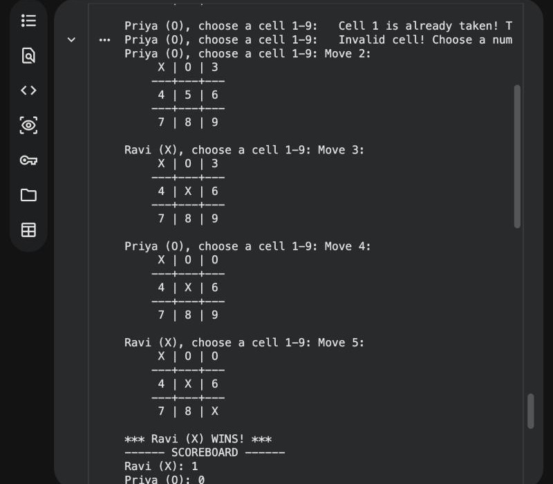
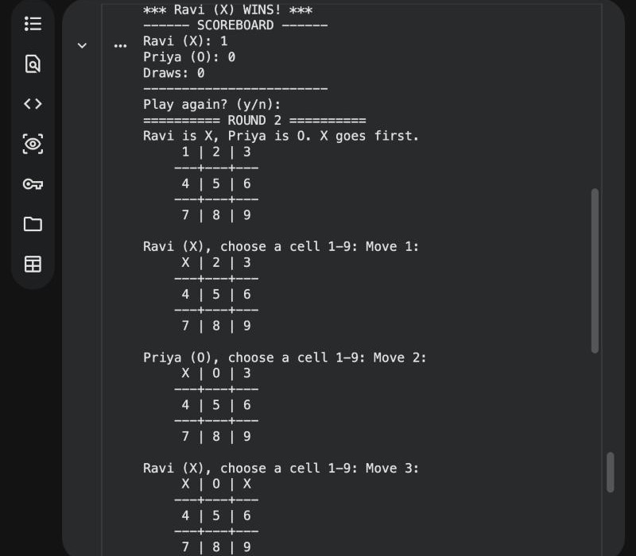
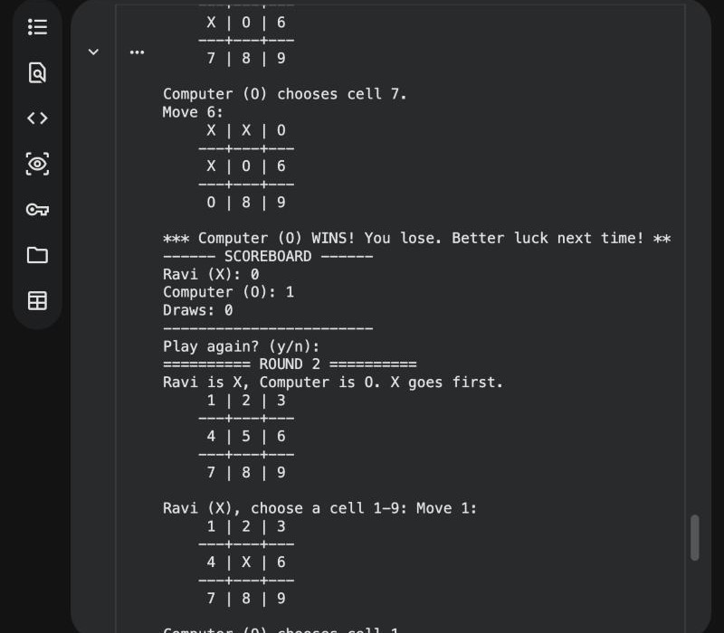
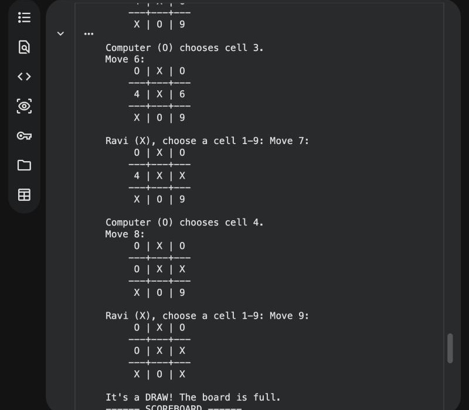

# Mini Game Project: Tic Tac Toe (C++)

A console-based Tic Tac Toe game in C++ that demonstrates core programming concepts: **loops**, **arrays** and **conditional logic**.

[](https://colab.research.google.com/github/suma544/tic-tac-toe-game/blob/main/Tic_Tac_Toe_Game.ipynb)

## Key Features
- **Loops, arrays and conditions for game logic**
  - `char board[3][3]` 2D array stores the board
  - `LINES[8][3]` array holds all 8 winning lines (3 rows, 3 columns, 2 diagonals)
  - Loops run the game turns, the replay option, the menu, board drawing and win checks
  - `if/else` conditions check moves (cell taken / out of range) and find a winner or a draw
- **The board is redrawn after every move**, with a move counter
- **Win / loss / draw detection** after each move
- **Replay option:** "Play again? (y/n)" after every round, with a scoreboard
- **Two modes:**
  - Player vs Player
  - Player vs Computer. The computer tries to win, then block, then takes the center, then a corner, then a side.
- **Overall statistics** across all games

## How to Play
Cells are numbered 1-9. Enter a number to place your mark:
```
     1 | 2 | 3
    ---+---+---
     4 | 5 | 6
    ---+---+---
     7 | 8 | 9
```
Get 3 in a row (horizontal, vertical or diagonal) to win.

## Files
| File | Description |
|------|-------------|
| `tic_tac_toe.cpp` | Full C++ source code |
| `Tic_Tac_Toe_Game.ipynb` | Google Colab notebook that writes, compiles and plays the game |
| `sample_input.txt` | Moves used for the demo run |
| `output/colab_output.txt` | Full output from the Google Colab run |
| `output/*.jpg` | Screenshots of the Colab run |

## Run it yourself
**Google Colab:** click the badge above, then *Runtime → Run all*.

**Locally (interactive):**
```bash
g++ -std=c++17 -o tic_tac_toe tic_tac_toe.cpp
./tic_tac_toe
```

## Output Screenshots (Google Colab)




